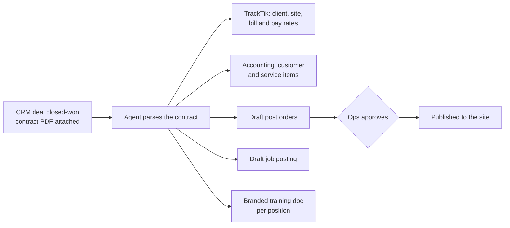

# What's possible beyond these skills

The skills in this repo read TrackTik and help you analyse and draft. These are the larger systems I've built on
top of the same data. They aren't open-sourced because each one is wired into a company's own contracts,
accounting and approval rules, but the patterns carry over to any guard company running TrackTik.

## 1. Closed deal → fully onboarded site

When a deal is marked closed-won in the CRM, with the signed contract attached as a PDF:

Setup work that took days of re-keying across systems takes minutes. Post orders stay a draft until operations
approves them (Tier 3).

## 2. Approvals in Teams (Tier 2)

Agents post a card to an ops channel with **Approve / Reject / Adjust**. Nothing goes to an officer or client
until someone taps Approve, and every decision is logged. This is what makes it safe to let agents take
operational actions.

## 3. TrackTik → accounting billing sync

Approved TrackTik invoices become draft invoices in the accounting system automatically, around the clock. There's
an exception queue for anything that doesn't map cleanly (a new site, an unmapped line item) and alerts when
something needs a person. No more re-keying invoices, and no more invoices missed at month-end.

## 4. Site risk council for QBRs

The full version of `site-risk-snapshot`. It combines 90 days of TrackTik incidents with local crime data, FEMA
hazard data and FBI crime statistics, scores the site, and tracks that score quarter over quarter. Clients see
their risk going down, which is about the best renewal conversation there is.

## 5. Continuous audits

Everything in this repo runs on request. Turning it into **always-on monitoring**, with break-policy checks,
billing against actual punches and coverage gaps flagged as they happen, is a scheduling and alerting problem, not
an AI problem. It's also where most of the money is saved.

---

## Where TrackTik is heading

Trackforce has an **MCP server** on its roadmap, which will let Claude, ChatGPT, Copilot and other AI tools talk
to TrackTik directly. These skills use the REST API, which is available today. The logic in them (what to pull,
what to check, how to write it up) carries over to MCP unchanged.

**Want something like this for your company?** [Connect with me on LinkedIn](https://www.linkedin.com/in/leeandrews9/).
